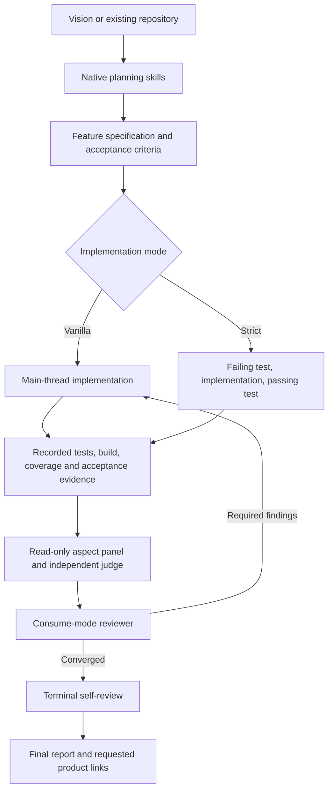

# Native Copilot architecture

Zensu combines product planning, implementation and lifecycle tracking. This
package runs those workflows directly in GitHub Copilot CLI. The maintained
policy and workflow sources are part of this package; no other coding host or
plugin is loaded. See the [runtime contract](copilot-runtime.md) and the
[complete feature map](parity.md) for host boundaries.

## Planning, implementation and tracking

Planning skills turn a vision or an existing repository into tracked features,
security profiles, journeys and tiers. `/zensu-bootstrap` starts a new product;
`/zensu-ghost-scan` discovers existing behavior. A project that also has a forward
plan can import existing features first and then add the planned remainder.

Implementation stays in the main thread. `/zensu-tdd` defaults to vanilla mode,
which permits direct implementation while retaining evidence and review gates.
Strict mode adds RED → IMPL → GREEN phase enforcement. The mode is frozen when
a chain begins; a later configuration change governs the next chain. Session
choice overrides the caller default, which overrides configuration.

Both modes produce the configured read-only aspect panel, optional independent
judge, consume-mode code reviewer, bounded finding fixes and terminal self-review.
Tracked work additionally links tests, source and documentation through the Zensu
CLI. The dashboard presents the resulting product lifecycle state.

## Native execution boundary

The Agent Plugins manifest registers 32 skills, six agents and 11 Copilot hook
events. `hooks/native/dispatcher.js` validates native event envelopes and invokes
the handlers in `hooks/registry.json`. The policies consume native tool names,
arguments and outcomes. Flat native decisions return to Copilot directly.

`sessionStart` establishes session/project/install observations. `preToolUse`
gates tools, inspects every patch endpoint and search root, and binds approved
Bash commands to the executing session. `postToolUse` evaluates actual outcomes;
failed calls cannot advance success state. Native child identities establish
read-only roles and evidence leases. `agentStop` enforces unfinished obligations;
a host continuation limit leaves them pending.

Unknown mutating tools and ambiguous schemas are denied. The native PowerShell
and dynamic-workflow surfaces are not interpreted as Bash or direct review tasks.
The package does not infer authority from assistant narration or a successful
background-task dispatch.

## Evidence and authority

[Evidence discipline](evidence-discipline.md) requires claims to cite actual
observations. Its complete normative block is carried by the startup/child hook,
each specialist agent and each skill. [Best solution first](best-solution-first.md)
governs how alternatives are presented, subject to user instructions and any
fixed workflow output order. The doctor checks the actual canonical blocks and
carrier registrations in the executing installation.

Machinery enforces the parts that can be checked: session-bound workflow state,
private read leases, one-use review tickets, real command execution records,
working-tree-bound suite evidence and acceptance verification. See
[the gates](gates.md) and [review chain](review-chain.md) for those contracts.
Configuration may control optional behavior, but a configuration value cannot
manufacture a missing human decision or an observed successful execution.

Human plan approval comes from the uniquely correlated native
`human_response.recorded` event and its exact accepted plan bytes. Browser consent
comes from the exact native permission request and a human-response completion.
Child or unclassified ownership cannot establish main-thread approval. Transcript
readers inspect native `events.jsonl` directly; there is no projected transcript.

## Durable state and recovery

Session Control binds the project, native session, authority and runtime digest.
Workflow state uses compare-and-swap updates and preserves pending work across
interruptions. Reanchor inspects private observations and native Copilot session
inventory; unknown activity prevents an unsafe transfer. A record's existence
alone is not process liveness.

`/zensu-session-trail` reads native workspace metadata and event history for
inspection, handover and lineage. It never resumes a child as an independent
session or substitutes historical approval for a new user decision. See
[session control](session-control.md) and [operations](operations.md).

A work-order launcher selects one native plugin installation, owns process and
lease supervision, and consumes the native result stream. Missing success,
lease loss or cancellation cannot report completion. Backend work orders require
separate live acceptance with authorized test data.

## Build and verification

The build copies maintained source files byte-for-byte. It needs no original
source-host checkout and performs no code or protocol conversion. `build.json`
records the emitted paths and SHA256 hashes. Install or reinstall the frozen
package before opening a new session; do not replace files under an active run.

The native suite covers protocol, identity, permissions, policy, session history,
evidence, review closure, acceptance and launcher control. Hermetic packaging
checks verify source independence and deterministic output. Historical source-host
measurements and tests are not evidence about this runtime. In particular, no
source-host hook-output size threshold or Desktop behavior is claimed for Copilot.
Current live observations are recorded in [runtime validation](copilot-runtime.md).

Local implementation and review work without a Zensu account. Product tracking
requires the Zensu CLI and login; forge publication requires the selected forge
CLI; browser and other artifact validation require their driver tools. Missing
external capabilities remain explicit gaps, not inferred successful execution.
